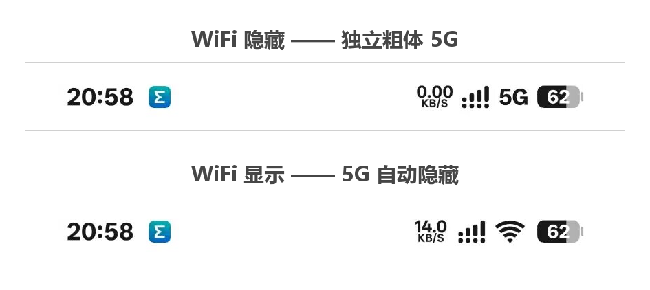

# iOS Net Type 1.1.0

ColorOS 状态栏 LSPosed 模块：保留原有 iOS 风格的独立粗体 5G/4G 显示，与 WiFi 图标互斥，并去除移动信号和 WiFi 的数据活动小箭头。信号、WiFi 扇形、电池和充电图形沿用系统原生资源；不包含 iOS PNG 素材。

## 效果展示



## 使用方法

### 环境要求

- 手机已 Root，并安装了正常工作的 LSPosed。
- Android 13（API 33）及以上的 ColorOS/Oplus SystemUI 设备（兼容性详见「适配范围」）。
- 模块没有设置页面，启用后无需任何配置。

### 安装步骤

1. 安装 `dist/iOSNetType-1.1.0-release.apk`。
2. 在 LSPosed 模块列表中启用 iOS Net Type。
3. 作用域只勾选“系统界面 / com.android.systemui”。
4. 重启手机。Hook 在 SystemUI 进程启动时注入，必须重启后才会生效。

### 生效后的表现

- 状态栏信号图标旁出现独立粗体的 5G/4G 文字，颜色跟随状态栏图标着色。
- WiFi 图标显示时该文字自动隐藏；WiFi 隐藏时按实际网络类型恢复显示（互斥）。
- 原本焊在信号图标上的网络类型角标不再绘制，改由独立视图显示。
- 移动信号和 WiFi 图标上的数据活动小箭头（上传/下载三角）被移除。

### 验证与日志

- 观察状态栏是否符合上述表现。
- 通过 `adb logcat -s iOSNetType` 或 LSPosed 模块日志查看日志；正常加载时会出现 `loading into systemui`、`slot mobile registered` 等输出。

## 从测试版升级

正式版使用独立发布签名。之前使用调试签名的测试版需要先卸载，再安装正式版，并在 LSPosed 中重新启用及选择系统界面作用域。后续正式版继续使用同一发布私钥，即可覆盖升级。模块没有设置页面或需要迁移的用户配置。

## 适配范围

当前实现依据 ColorOS/Oplus SystemUI，已在 RMX5010 双卡设备验证核心互斥逻辑。不保证兼容 AOSP、其他厂商 ROM 或所有 ColorOS 版本。单卡/停用 SIM、不同运营商及后续 OTA 需要单独验证；找不到某个 Hook 时记录日志，不会因此阻止其他独立 Hook 安装。Android 最低安装版本为 13（API 33），这不等于所有 Android 13 及以上系统都兼容。

## 从源码构建

需要 Python 3.10+、JDK 17、Android SDK Platform 35+ 和 Build Tools 35+。把 `ANDROID_SDK_ROOT` 或 `ANDROID_HOME` 设置为 SDK 目录，`java`/`javac`/`keytool` 加入 PATH。本机 `tools` 下保留了最小构建依赖作为回退；源码发布 ZIP 不打包 SDK。

正式签名配置放在 `.private/signing.json`，可参考 `signing.example.json`。其中 `keystore` 和 `password_file` 都相对于配置文件目录。密码文件只放一行密码。首次自行构建时，创建 `.private`，交互运行：

```bash
keytool -genkeypair -storetype PKCS12 -keystore .private/release.keystore \
    -alias iosnettype-release -keyalg RSA -keysize 3072 -validity 10000
```

将同一个密码写入 `.private/release-password.txt`，再复制 `signing.example.json` 为 `.private/signing.json`。务必将发布私钥、密码和配置另行安全备份，不能随源码公开。

构建：

```bash
python build.py
```

产物：`dist/iOSNetType-1.1.0-release.apk` 及同名 `.sha256` 校验文件。脚本自动清理 `build` 目录，完成编译、双 dex 打包、对齐、签名、验签和打包内容检查。源码 ZIP 不含任何签名材料。若需要测试调试签名包，把本人的调试密钥置于 `.private/debug.keystore`（androiddebugkey，密码 android），运行 `python build.py --debug`。

## 目录

| 目录/文件 | 说明 |
| --- | --- |
| `src/` | 三个核心类：Hook、独立网络类型视图、状态分发 |
| `stubs/` | 仅用于编译的 SystemUI、Kotlin、Xposed 接口；不打入 APK |
| `AndroidManifest.xml` | 模块元数据及 SystemUI 作用域 |
| `version.json` | 版本名及版本号 |
| `build.py` | 无 Python 第三方依赖的构建脚本 |
| `dist/` | 本机生成的分发文件，不提交源码 |
| `docs/` | README 效果展示图片 |
| `.private/` | 本机签名材料，不提交或分发 |

## 故障处理

如果安装后没有效果，检查 LSPosed 启用状态及作用域并重启。如遇系统界面不兼容，在 LSPosed 中禁用模块并重启。模块日志前缀为 `iOSNetType`；部分 LSPosed 环境只在模块日志中提供 Hook 输出。
